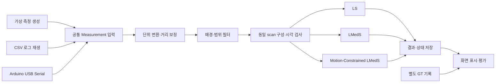
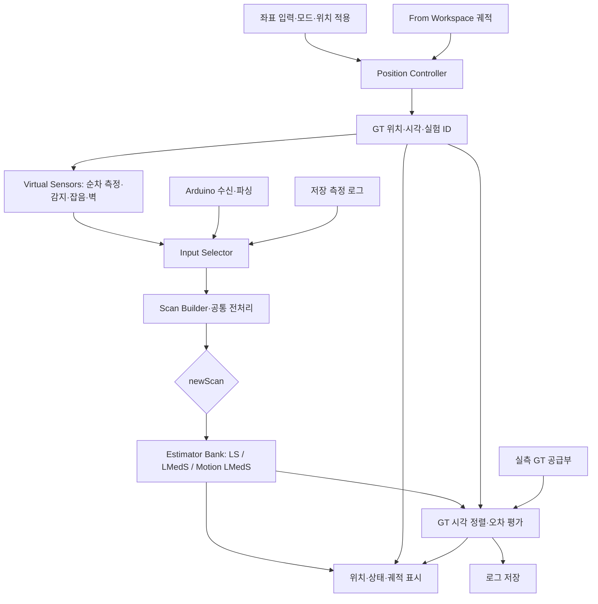

# MATLAB 초음파 위치추정 모델링 및 Arduino 연동 상세계획

작성일: 2026-10-27  
문서 범위: 구현 전 설계 계획. 아래 파일 구성·함수·통신 형식은 앞으로 구현할 명세이며, 구현 또는 실험 완료 결과가 아니다.

## 1. 목표와 확정 조건

1 m × 1 m 정사각형 공간에서 로봇 위에 설치한 작은 반사 타깃의 2차원 위치를 추정한다. 벽에 고정한 초음파 센서 6개는 모두 공간 중앙을 향한다. 처음에는 MATLAB 가상 측정으로 알고리즘을 검증하고, 이후 입력만 Arduino 실측 데이터로 교체한다.

| 항목 | 설계 조건 |
|---|---|
| 공간 | 수평 1 m × 1 m |
| 센서 | 서로 마주 보는 두 벽에 각각 2개, 나머지 두 벽에 각각 1개, 총 6개 |
| 설치 방향 | 모든 센서가 중앙 (0.5, 0.5)을 향함 |
| 센서 위치 | 4개는 모서리 부근, 2개는 나머지 벽 중앙 부근 |
| 측정 대상 | 로봇 몸체가 아닌 상부 반사 타깃 |
| 타깃 크기 | 작지만 반지름 r을 수식과 설정값에 유지 |
| 추정 대상 | 반사 타깃 중심 좌표 (x, y) |
| 로봇 이동 | 큰 몸체 때문에 중앙의 제한된 영역에서 이동 |
| 알고리즘 | LS, LMedS, Motion-Constrained LMedS 비교 |
| 계산 분담 | Arduino는 센서 구동·거리 취득, MATLAB은 전처리·위치추정·표시·저장 |
| 입력 모드 | 시뮬레이션, 저장 데이터 재생, Arduino 실시간 입력 |

이번 단계는 TDOA나 40 kHz 원파형 처리가 아니다. 일체형 초음파 센서가 제공하는 거리값으로 위치를 구한다. 따라서 PC와 Arduino의 초정밀 시각 동기화는 TDOA처럼 요구되지 않지만, 순차 측정 중 이동 오차를 다루기 위한 센서별 측정 시각은 필요하다.

## 2. 아직 확정하지 않은 값

다음 값은 코드에 숨겨 넣지 않고 설정 파일에서 관리한다. 모르는 값은 실측 미완료로 표시한다.

| 설정 | 결정 방법 |
|---|---|
| 로봇 몸체 가로·세로 또는 외접 반지름 | 실제 치수 측정 |
| 반사 타깃 반지름·형상·높이 | 최종 제작물 측정 |
| 타깃과 로봇 중심의 수평 오프셋 | 설치 후 측정, 가능하면 0으로 정렬 |
| 센서 송수신면 좌표와 높이 | 브래킷 부착 후 측정 |
| 실제 센서 모델·SKU | Trig형과 I2C형을 구분하여 확인 |
| 최소·최대 거리, 거리 출력 해상도 | 해당 제품 사양과 실제 출력 확인 |
| 중앙 이동영역, 최대 이동속도 | 몸체 치수와 실험 조건으로 결정 |
| 벽 배경값, 거리 보정계수, 잡음 | 별도 보정 실험에서 산출 |
| 순차 Trigger 간격 | 제품 구동 제한과 간섭 실험으로 결정 |
| 이동 제약 여유값, 잔차 임계값 | 튜닝용 데이터로 결정 후 평가 전에 고정 |

예제 좌표·속도·시간은 설계 설명용이다. 실제 성능이나 최적값으로 해석하지 않는다.

## 3. 좌표계와 센서 배치

### 3.1 전역 좌표

- 왼쪽 아래를 (0, 0), 오른쪽 위를 (1, 1)로 둔다.
- +x는 오른쪽, +y는 위쪽이다. 이 문서의 위·아래는 평면도 기준이다.
- 내부 계산은 m, s, rad로 통일한다.
- 표시 화면에서만 cm·degree로 변환한다.
- 센서 번호는 배선, MATLAB, CSV 로그에서 끝까지 동일하게 유지한다.

### 3.2 초기 좌표안

모서리 이격 a, 벽에서 안쪽으로 나온 송수신면 거리 b를 둔다. 초기 도면 설명값은 a = 0.05 m, b = 0.01 m이며 확정 설치 치수가 아니다.

| 센서 | 부착 벽 | 좌표 s_i |
|---|---|---|
| S1 | 아래, 왼쪽 모서리 부근 | (a, b) |
| S2 | 아래, 오른쪽 모서리 부근 | (1-a, b) |
| S3 | 위, 왼쪽 모서리 부근 | (a, 1-b) |
| S4 | 위, 오른쪽 모서리 부근 | (1-a, 1-b) |
| S5 | 왼쪽 중앙 | (b, 0.5) |
| S6 | 오른쪽 중앙 | (1-b, 0.5) |

중앙 c = [0.5, 0.5]^T에 대해 각 센서의 방향벡터와 방향각을 계산한다.

\[
\mathbf u_i=\frac{\mathbf c-\mathbf s_i}{\|\mathbf c-\mathbf s_i\|},\qquad
\theta_i=\operatorname{atan2}(c_y-y_i,c_x-x_i)
\]

센서 방향을 추정된 로봇 위치에 따라 회전시키지 않는다. 실제 하드웨어와 동일하게 고정 방향으로 유지한다. 모든 센서의 축이 중앙을 지나도록 설치하되, 감지 가능한 영역은 실측으로 확인한다.

### 3.3 몸체와 타깃을 분리

몸체는 충돌 판정에만 사용하고 초음파 거리식에는 타깃 반지름을 사용한다.

회전하지 않는 직사각형 몸체의 가로 W, 세로 H, 벽 여유 m에 대해 로봇 중심은 다음 범위를 벗어나지 않는다.

\[
W/2+m\le x_{robot}\le1-W/2-m,\qquad
H/2+m\le y_{robot}\le1-H/2-m
\]

그 안에 더 작은 중앙 실험영역 `roi`를 정한다. 아직 몸체 크기가 없으므로 최종 `roi`는 미확정이다. 회전을 허용한다면 외접원 또는 실제 회전 형상의 충돌 판정으로 바꾼다.

타깃 중심을 로봇 중심 위에 놓으면 수평 좌표는 같다. 오프셋 o와 로봇 방향 ψ가 존재한다면 p_target = p_robot + R(ψ)o이다. 방향을 측정하지 않을 계획이면 오프셋을 가능한 한 0으로 맞추거나 로봇 방향을 고정한다.

## 4. 반지름을 포함한 거리 모델

### 4.1 기본 가정

초기 모델은 수평 단면이 원형인 반사 타깃을 가정한다. 센서와 타깃의 유효 반사 높이를 맞추고, 센서가 타깃의 가장 가까운 표면을 감지한다고 근사한다.

이 가정에서 타깃 중심 p = [x, y]^T, 반지름 r, 센서 위치 s_i의 예상 표면 거리는 다음과 같다.

\[
\rho_i(\mathbf p;r)=\|\mathbf p-\mathbf s_i\|-r
\]

원시 거리 생성 모델은 다음처럼 분리한다.

\[
d_i^{raw}(t_i)=\alpha_i\rho_i(\mathbf p(t_i);r)+\beta_i+\epsilon_i+o_i
\]

- α_i: 센서별 거리 스케일 오차.
- β_i: 센서별 일정한 거리 편차.
- ε_i: 정상 측정 잡음.
- o_i: 이상값 실험에서 추가하는 오차. 실제로는 단순 가산이 아닌 벽 거리로의 교체도 포함한다.
- t_i: 해당 센서의 측정 기준 시각.

거리 보정 후 d_i = (d_i_raw - β_i)/α_i로 사용한다. 보정이 끝나지 않은 경우 α_i = 1, β_i = 0을 임시 사용하고 미보정 상태를 기록한다.

타깃 중심까지의 거리로 변환할 때는 D_i = d_i + r이다. 반지름을 무시하는 실험은 r = 0으로 별도 실행할 수 있지만 기본 수식에서 삭제하지 않는다.

### 4.2 모델 적용 한계

- 평판을 타깃으로 쓰면 모든 방향에서 같은 r을 빼는 원형 모델이 맞지 않을 수 있다. 최종 형상을 정한 뒤 이 가정을 검증한다.
- 센서와 타깃의 높이가 다르면 실제 거리는 수평거리와 다르다. 기본 모델은 높이를 맞춰 이 문제를 줄인다.
- 높이 보정이 필요하면 실제 타깃 형상에 맞춘 3차원 표면 거리식을 사용한다. 모든 형상에 동일한 높이 보정식을 적용하지 않는다.
- 센서 송신부·수신부의 유효 위치를 하나의 s_i로 근사한다. 작은 타깃과 가까운 거리에서 생기는 편차는 보정 실험에서 확인한다.
- 거리식에서 r을 무시할 정도로 작더라도, 타깃이 작아져 감지가 어려워지는 효과까지 무시할 수는 없다.

## 5. 사용자가 측정한 감지 범위 반영

### 5.1 측정값 해석

센서 정면 축 방향 거리 x_local을 고정하고 타깃을 옆으로 이동시켜 감지 경계를 찾았다고 해석한다. 여기서 거리는 센서가 표시한 사선거리가 아니라 정면 축 방향 거리이다.

\[
w(x_{local})=x_{local}\tan\theta_{half}
\]

| 정면 축 거리 | 편측 감지각 | 계산된 편측 감지 폭 |
|---|---|---|
| 0.20 m | 39° | 약 0.1620 m |
| 0.30 m | 29° | 약 0.1663 m |
| 0.40 m | 22° | 약 0.1616 m |

좌우 대칭은 임시 가정이다. 한쪽만 측정했다면 반대쪽도 측정하여 좌·우 경계를 따로 저장한다. 각도 측정 기준점이 타깃 중심인지 가장자리인지도 기록한다.

이 표는 해당 실험 타깃의 감지 경계이지 초음파 에너지가 존재하는 절대 경계가 아니다. 타깃 크기·재질이 바뀌면 감지 패턴이 달라질 수 있다.[S5] 새 반사 타깃으로 측정한 경계라면 그 안에 이미 타깃 크기의 영향이 포함되므로 감지 폭에 r을 다시 더하지 않는다.

### 5.2 센서별 로컬 좌표

센서 축 u_i와 그 수직벡터 v_i = [-u_iy, u_ix]^T에 대해:

\[
x_i^{local}=\mathbf u_i^T(\mathbf p-\mathbf s_i),\qquad
y_i^{local}=\mathbf v_i^T(\mathbf p-\mathbf s_i)
\]

측정이 존재하는 구간에서는 인접 감지 폭을 선형 보간한다. 임시 감지 판정은 x_local > 0이고 |y_local| ≤ w(x_local)인지 확인한다. 최소·최대 유효거리 조건도 따로 적용한다.

### 5.3 측정하지 않은 거리 처리

현재 0.20~0.40 m 밖의 감지 특성은 모른다. 중앙 타깃의 축 방향 거리는 위 초기 좌표에서 벽 중앙 센서 약 0.49 m, 모서리 부근 센서 약 0.665 m이다. 감지각 모델에는 중심의 축 방향 거리를, 거리 출력 모델에는 표면 거리를 사용하므로 둘을 혼동하지 않는다.

두 모드를 명시적으로 구분한다.

- **기하 검증 모드:** 모든 센서가 타깃을 감지한다고 가정하여 위치 계산만 검증한다. 화면에 ‘전 센서 감지 가정’이라고 표시한다.
- **실측 감지 모드:** 미측정 구간은 `UNCALIBRATED_COVERAGE`로 표시한다. 감지 불가가 확인된 것과 구분하고, 전체 영역 성능을 검증했다고 주장하지 않는다.

필요하면 미측정 구간의 낙관·보수 가정으로 민감도 실험을 별도로 할 수 있다. 이를 실제 감지 범위로 간주하지 않는다. 우선 실제 타깃으로 0.5~0.7 m 부근 및 예정 이동영역 양끝의 감지율을 측정한다.

## 6. 벽 반사 처리

### 6.1 기본 정책

벽 거리를 숫자로 빼는 방식이 아니라 벽 반사로 의심되는 측정을 위치 계산에서 제외한다. 센서가 벽 거리 하나만 출력한 경우 로봇 거리로 복구하지 않는다.

모서리 부근 설치와 중앙 조준은 유지한다. 다만 모서리 배치만으로 벽 반사가 사라진다고 가정하지 않는다. 센서 앞면이 벽·브래킷에 가리지 않게 하고 로봇 몸체가 아닌 상부 타깃을 향하는 높이로 설치한다.

### 6.2 빈 공간 배경 측정

실제 설치 및 순차 구동 순서를 유지한 채 로봇을 제거하고 센서별 배경 데이터를 수집한다. 초기 수집 목표는 센서당 200회 이상이며, 안정성에 따라 늘린다.

저장 항목:

- 원시 거리와 측정 시각.
- 정상 응답·타임아웃 비율.
- 배경 거리의 중앙값과 변동 범위.
- 반복적으로 나타나는 복수의 거리 군집.
- 센서 좌표·방향·높이, Trigger 간격, 설치 사진 식별자.

로봇이 있는 동안 배경 모델을 자동 갱신하지 않는다. 정지한 로봇을 벽으로 학습할 수 있기 때문이다. 설치가 바뀌면 다시 측정한다.

### 6.3 배경 필터 명세

배경 군집 중심 μ_ij, 허용 폭 δ_ij에 대해:

\[
\min_j |d_i-\mu_{ij}|\le\delta_{ij}\quad\Rightarrow\quad\text{BACKGROUND\_SUSPECT}
\]

이는 보수적인 제외 정책이다. 실제 타깃 거리와 겹치면 정상 측정도 제외될 수 있으므로, 타깃을 넣은 검증 실험에서 오제거율을 확인한다. 단일 ‘벽보다 가까우면 무조건 로봇’ 규칙으로 끝내지 않는다.

타깃 반지름을 포함하여 공통 중앙 탐색영역 Ω에서 센서별 가능 거리 구간도 계산한다.

\[
d_{i,min}^{ROI}=\min_{p\in\Omega}\rho_i(p;r),\qquad
d_{i,max}^{ROI}=\max_{p\in\Omega}\rho_i(p;r)
\]

보정 불확실성만큼 여유를 두고 이 범위 밖을 제외한다. 세 알고리즘 모두 같은 ROI를 사용한다. 배경과 ROI 예상 거리 구간이 많이 겹치는 센서는 타깃 높이·실험영역·설치 간격을 다시 검토한다. 중앙 조준 조건은 유지한다.

### 6.4 시뮬레이션의 벽 모델 수준

처음부터 완전한 음향 파동 해석을 만들지 않는다.

1. 빈 공간 기하를 그림으로 표시하고 중심축과 벽의 교점을 참고 거리로 계산한다.
2. 실제 배경 로그가 없으면 명시적 가정으로 벽 거리 샘플을 생성한다.
3. 배경 로그 확보 후 실제 분포에서 벽 거리·타임아웃을 재생한다.
4. 타깃을 감지하는 경우에도 일부 측정을 벽 값으로 교체하여 벽 우세 반사 상황을 시험한다.

중심축과 벽의 교점이 센서의 실제 출력 거리라고 단정하지 않는다. 가상 측정기의 ‘이 값은 벽에서 생성됨’ 정답 라벨은 평가용으로만 저장하며 위치추정기에 전달하지 않는다.

## 7. 전체 소프트웨어 구조



시뮬레이션, 로그 재생, 실시간 입력의 차이는 데이터 공급부에만 둔다. `processScan` 이후의 전처리·추정 함수는 동일하게 사용한다. GT는 평가기에만 전달한다.

## 8. 공통 데이터 형식

### 8.1 센서 측정 1개: Measurement

| 필드 | 형식·단위 | 의미 |
|---|---|---|
| session_id | 문자열 또는 정수 | 전원 재시작·측정 세션 구분 |
| scan_id | 정수 | S1~S6 한 순회의 번호 |
| sensor_id | 1~6 | 센서 번호 |
| t_trigger_us | 정수, µs | Arduino Trigger 시각 |
| t_done_us | 정수, µs | 응답 처리 또는 타임아웃 종료 시각 |
| range_raw_mm | 수치, mm | 보정 전 센서 표면 거리, 미검출은 NaN |
| hw_status | 열거값 | OK / TIMEOUT / OUT_OF_RANGE / DEVICE_ERROR |
| t_receive_pc | PC 시각 | 통신 지연·누락 진단용 |

PC 수신시각을 센서 측정시각으로 대체하지 않는다. 추정용 `t_measure`는 1차 구현에서 Trigger 시각으로 정의하고 로그 메타데이터에 기록한다. 더 정밀한 측정 시각 정의가 필요하면 센서 응답 방식 확인 후 수정한다.

Arduino의 µs 카운터가 32비트이면 약 71.6분에 되돌아온다. MATLAB에서 래핑을 풀어 단조 증가 시각으로 변환하고, 보드 재시작은 새로운 세션으로 처리한다.

### 8.2 추정 입력 1회: Scan

```text
scan.session_id
scan.scan_id
scan.sensor_ids[6]
scan.t_measure_s[6]
scan.range_raw_m[6]
scan.range_corrected_m[6]
scan.valid_mask[6]
scan.reject_reason[6]
scan.t_reference_s
scan.time_span_s
```

동일 session_id·scan_id만 묶는다. 늦게 도착한 이전 scan의 값을 다음 scan에 끼워 넣지 않는다. 프레임을 닫는 대기시간은 설정값으로 두고, 누락 센서는 유효하지 않은 상태로 남긴다. 알고리즘별 결과의 GT 비교 시각을 같게 하기 위해 `t_reference`는 공통 전처리에서 선택한 유효 측정 시각의 평균으로 한 번만 정한다.

### 8.3 출력 1회: Estimate

```text
estimate.algorithm
estimate.scan_id
estimate.t_reference_s
estimate.position_m[2]       % 유효한 새 위치가 없으면 NaN
estimate.status             % 아래 상태 목록
estimate.used_sensor_ids
estimate.residuals_m
estimate.inlier_mask
estimate.geometry_condition
estimate.compute_time_ms
estimate.position_age_s
```

상태 예시: `VALID`, `INSUFFICIENT_SENSORS`, `POOR_GEOMETRY`, `NO_CONSENSUS`, `TIME_SPAN_TOO_LARGE`, `MOTION_REJECTED`, `REINITIALIZING`.

화면에서 마지막 위치를 유지할 수는 있지만 회색으로 표시하고 오래된 값임을 알린다. 유지 위치를 새 위치추정 성공으로 계산하지 않는다.

## 9. 위치추정 알고리즘

### 9.1 공통 잔차

\[
e_i(p)=d_i-\left(\sqrt{(x-x_i)^2+(y-y_i)^2}-r\right)
\]

기본 비교는 보정된 동일 거리와 동일 유효 센서 목록을 사용한다. 초기 구현은 비가중 잔차를 사용한다. 센서별 분산으로 정규화하려면 세 방법의 평가·재추정에 일관되게 적용하고 별도 실험 조건으로 기록한다.

### 9.2 LS

\[
\hat p_{LS}=\arg\min_{p\in\Omega}\sum_{i\in V}e_i(p)^2
\]

- 최소 3개의 유효 센서를 요구하는 공통 운용 규칙으로 시작한다.
- 여러 초기값 또는 ROI 격자 탐색 후 연속 최적화로 단일 초기값 의존성을 줄인다.
- 이전 추정 위치, 중앙, 격자 최솟값을 초기값 후보로 사용할 수 있다. GT는 사용하지 않는다.
- `lsqnonlin` 사용 시 잔차 벡터를 반환하고 ROI 경계를 지정한다.[S3]
- Optimization Toolbox가 없다면 `fminsearch`에 잔차 제곱합과 명시적 경계 처리 또는 경계 내 변수변환을 사용한다. `fminsearch` 자체는 무제약 방법이다.[S4]

설치된 MATLAB 버전·툴박스는 구현 시작 때 확인한다. 이 문서에서 설치 여부를 확정하지 않는다.

### 9.3 LMedS

1. m개의 유효 센서에서 3개씩 조합한다. 최대 6개이면 20개 조합이다.
2. 각 조합으로 위치 후보를 만든다. 조합해가 유일하다고 가정하지 않고 필요하면 여러 초기값을 사용한다.
3. ROI 밖 후보, 계산 실패, 나쁜 기하조건 후보를 제외한다.
4. 모든 공통 유효 센서에 대해 후보별 점수 J(p) = median(e_i(p)^2)를 계산한다.
5. 가장 작은 점수의 후보를 선택한다.
6. 보정 실험 기반 잔차 임계값으로 inlier를 골라 LS로 재추정한다.
7. inlier 수·기하조건이 충분하지 않으면 실패로 기록한다.

유효 센서가 3개이면 조합이 하나뿐이므로 이상값을 견디는 중복 정보가 부족하다. ‘센서 3개 이상이면 항상 정확’ 또는 ‘LMedS면 모든 이상값 제거 가능’이라고 가정하지 않는다. 잔차 임계값에 사용하는 잡음 하한은 거리 해상도·실측 반복오차를 반영해 0이 되지 않도록 한다.

### 9.4 Motion-Constrained LMedS

기존 LMedS 후보 생성·점수 계산을 유지하고, 후보 평가 전에 이동 가능영역 조건을 추가한다.

\[
\Delta t=t_{reference,k}-t_{last\ valid},\qquad
d_{max}=v_{max}\Delta t+m_{motion}
\]

\[
\|p_{candidate}-p_{last\ valid}\|\le d_{max}
\]

- `v_max`는 실제 실험에서 허용할 최대속도이다.
- `m_motion`은 이전 위치 불확실성·모델 오차를 위한 여유 거리이다.
- 반사 타깃 반지름 r과 이동 여유값 m_motion은 서로 다른 변수이다.
- 재추정된 최종 위치에도 동일한 이동 조건을 다시 검사한다.
- 첫 프레임은 이동 제약 없이 LMedS로 초기화한다.
- 모든 후보가 제외되면 이번 scan은 실패로 표시한다.
- 연속 실패나 마지막 신뢰 위치의 경과시간이 설정 한계를 넘으면 재초기화를 시도한다. 예를 들어 연속 3회는 튜닝용 시작값일 뿐 확정값이 아니다.
- 재초기화는 잔차·기하조건을 통과한 후보가 연속 관측에서 일관될 때 승인하도록 설계한다.

마지막 신뢰 위치가 이미 틀리면 이동 제약이 정상 후보를 계속 제거할 수 있다. 이 상황을 별도의 실패 실험으로 포함한다. 예측 위치만으로 신뢰 상태를 계속 갱신하지 않는다.

### 9.5 기하조건 검사

후보 위치에서 거리식의 Jacobian 행은 다음과 같다.

\[
J_i=\left[\frac{x-x_i}{\|p-s_i\|},\frac{y-y_i}{\|p-s_i\|}\right]
\]

Jacobian의 특이값과 조건수를 확인한다. 예를 들어 좌우 중앙 센서만으로는 중앙에서 y 방향 변화를 안정적으로 구분하기 어렵다. 센서 개수와 함께 기하조건을 기록하고, 거의 일직선인 조합은 후보 계산에서 제외한다. 조건수 임계값은 실험 전에 정해 모든 방법에 동일하게 적용한다.

## 10. Arduino 구동 및 MATLAB 통신

### 10.1 역할 분담

| Arduino | MATLAB |
|---|---|
| 센서별 순차 Trigger | USB Serial 수신·파싱 |
| 응답 취득과 타임아웃 관리 | 단위 통일·거리 보정 |
| 측정 시각 기록 | 벽 배경 필터·scan 구성 |
| 센서 ID·scan ID 부여 | LS·LMedS·제안 방법 계산 |
| 보정 전 거리와 상태 전송 | 궤적·센서 상태 표시·로그 저장 |

고속·일정한 Trigger 타이밍은 Arduino가 관리한다. MATLAB에서 USB 명령을 한 번씩 보내 센서 타이밍을 제어하는 방식을 기본으로 삼지 않는다.

PPT의 예정 센서가 URM09 Trig SEN0388이라면 신호선 하나에서 Trigger와 Echo를 전환하는 방식이다. I2C형과 통신 코드를 혼용하지 않는다. 공식 사양에는 최대 측정 빈도 25 Hz와 거리 해상도 1 cm가 명시되어 있으므로, 실제 제품·출력에 맞춰 반복 주기와 양자화 모델을 설정한다.[S6] 이는 센서 6개 전체 위치 결과가 25 Hz로 갱신된다는 뜻이 아니다.

### 10.2 순차 측정 간격

`T_slot`: 연속 센서의 Trigger 시작 사이 간격.  
`T_scan`: S1부터 S6까지 한 순회의 반복 주기.  
`T_quiet`: 응답 처리 후 다음 Trigger 전까지의 대기시간.

고정 슬롯이면 T_scan ≈ 6 T_slot이다. 타임아웃·통신 처리에 따라 실제 시각은 달라질 수 있으므로 로그로 확인한다. 같은 센서의 반복 주기는 제품 제한을 만족해야 하고, 다른 센서로 전환하는 간격은 음향 간섭 실험으로 별도 결정한다.

예시로 T_slot = 60 ms이면 T_scan ≈ 360 ms, 전체 위치추정 입력 빈도는 약 2.8 Hz이다. 이는 산술 설명용이며 권장 최적 간격이 아니다. 공간이 1 m라고 왕복 비행시간만 계산해 기다림을 끝내지 않는다. 센서 내부 처리와 잔향도 고려한다.

### 10.3 제안 전송 형식

초기 구현은 줄바꿈으로 끝나는 CSV를 사용한다. 다음은 앞으로 Arduino와 MATLAB 양쪽에서 맞춰 구현할 프로토콜이며 기존 펌웨어 출력 형식이 아니다.

```text
M,1,session_id,scan_id,sensor_id,t_trigger_us,t_done_us,range_mm,status
M,1,7,120,1,12000000,12004000,640,OK
M,1,7,120,2,12060000,12085000,nan,TIMEOUT
```

- `M`: 측정 레코드, `1`: 프로토콜 버전.
- 숫자 예시는 임의 데이터이며 실제 측정값이 아니다.
- 실패는 0 m로 보내지 않고 `nan`과 실패 사유로 보낸다.
- 보정하지 않은 거리와 상태를 전송한다. 펄스폭 기반 센서라면 디버깅용 원시 펄스폭 필드를 추가할 수 있다.
- 디버깅 메시지는 별도 접두어로 구분하고 측정 parser가 무시하게 한다.
- 바이트/초 예산은 평균 줄 길이 × 센서 측정 수/초로 계산한다. 115200 baud는 초기 연결 후보이며 실제 보드에서 확인한다.
- 잘못된 필드 수, 중복 번호, 비정상 sensor_id, 끊긴 줄을 검출해 기록한다.

### 10.4 MATLAB 수신 예시

아래는 연결 구조 예시이며 `onSensorLine` 등은 이후 구현할 함수이다. COM 번호는 실제 장치 포트로 바꾼다.

```matlab
port = serialport("COM3", 115200);
configureTerminator(port, "LF");
configureCallback(port, "terminator", @onSensorLine);

% onSensorLine(src, event):
% 1) line = readline(src)
% 2) 원문·PC 수신시각 기록
% 3) 프로토콜 검증 및 Measurement 큐에 추가
% 4) 즉시 반환

% 별도 처리 루프에서 완성되거나 마감된 scan을 가져와 processScan 실행
% 종료 시 configureCallback(port, "off") 후 연결 객체 정리
```

공식 `serialport`의 terminator callback 구조를 사용한다.[S1][S2] callback 안에서 20개 조합 최적화와 화면 전체 갱신을 실행하지 않는다. 수신·큐 적재와 추정·화면 갱신을 분리해 통신 누락을 줄인다. Arduino IDE Serial Monitor와 MATLAB이 같은 포트를 동시에 열지 않게 한다.

## 11. 순차 측정으로 생기는 시간차 처리

센서 6개는 서로 다른 t_i에서 로봇을 본다. 이 차이는 기록만 한다고 사라지지 않는다.

1차 구현에서는 정지 실험과 저속 이동을 사용하고, 아래 상한을 검사한다.

\[
\Delta t_{span}=\max_i t_i-\min_i t_i,\qquad
E_{motion,bound}=v_{max}\Delta t_{span}
\]

허용할 scan 내 이동량 예산을 넘으면 `TIME_SPAN_TOO_LARGE`로 표시한다. 예를 들어 속도 0.1 m/s, 시각 차 0.30 s이면 scan 동안 최대 3 cm 이동할 수 있다. 이를 센서 잡음이나 알고리즘 오차로만 해석하지 않는다.

2차 확장에서는 이전 신뢰 관측으로 얻은 속도 추정값을 이용해 다음 모델을 검토한다.

\[
p(t_i)\approx p(t_{ref})+\hat v_{prev}(t_i-t_{ref})
\]

이 확장을 사용할 경우 세 방법에 공통으로 적용하고, 동일한 공통 속도 입력을 사용할지 방법별 상태를 사용할지 평가 설계에 명시한다. 이동 제약만의 효과를 비교하는 기본 실험에서는 시간 보상 정책을 동일하게 유지한다. 정답 속도는 추정기에 제공하지 않는다.

## 12. MATLAB 프로젝트 파일 구성

```text
ultrasonic_localization/
  main_simulation.m             # 가상 측정 실행
  main_replay.m                 # 저장 로그 재생
  main_live.m                   # Arduino 입력 실행
  config/
    makeConfig.m               # 좌표·단위·알고리즘 설정
    sensorGeometry.csv         # 실측 송수신면 좌표·높이
    detectionBoundary.csv      # 센서·타깃별 감지 경계
    rangeCalibration.csv       # 거리 보정계수
    backgroundModel.mat        # 빈 공간 배경 분포
  acquisition/
    simulateMeasurements.m
    readReplayMeasurements.m
    parseSerialLine.m
    onSensorLine.m
    assembleScan.m
  geometry/
    sensorLocalCoordinates.m
    expectedSurfaceRange.m
    checkCoverage.m
    checkRobotCollision.m
    checkGeometryCondition.m
  processing/
    calibrateRanges.m
    rejectBackground.m
    validateScan.m
    processScan.m
  estimation/
    estimateLS.m
    estimateLMedS.m
    estimateMotionLMedS.m
    generateCandidates.m
    updateTrackingState.m
  display/
    initializeDashboard.m
    updateDashboard.m
  evaluation/
    alignGroundTruth.m
    computeMetrics.m
    exportExperimentReport.m
  tests/
    testIdealGeometry.m
    testInputEquivalence.m
    testInvalidMeasurements.m
    testMotionAndRecovery.m
  data/
    raw/
    processed/
    ground_truth/
  results/
```

상태는 `state.LS`, `state.LMedS`, `state.MotionLMedS`로 분리한다. 공통 설정·보정은 공유하지만 한 방법의 성공 위치가 다른 방법의 이전 신뢰 위치를 덮어쓰지 않게 한다.

핵심 함수 인터페이스 초안:

```matlab
[scan, measurementLog] = assembleScan(measurements, cfg);
[result, state] = processScan(scan, cfg, state);

% result.LS, result.LMedS, result.MotionLMedS
% 시뮬레이션 정답 위치는 위 함수에 전달하지 않음
```

구현은 MATLAB 계산 함수를 Simulink Subsystem으로 연결하는 구조로 진행한다. 사용자가 좌표를 설정하는 GT 생성부와 GT·추정 위치 비교 화면을 초기 구현에 포함한다. 구체적인 블록 연결과 조작 방식은 18절을 따른다. 일반 `.m` 코드 또는 Simulink 모델 시뮬레이션과 SILS는 구분한다. SILS 검증을 주장하려면 실제 배포 대상 소프트웨어 또는 컴파일한 코드가 동일 입력에서 모델과 일치하는지 검증하는 단계를 추가해야 한다. 현재 계획은 먼저 PC의 Simulink에서 알고리즘 검증과 Arduino 계측 연동을 완료하는 것이다.

## 13. 화면 구성

### 13.1 평면도

- 정사각형 벽, 센서 ID·실제 위치·고정 방향.
- 몸체 외곽과 작은 반사 타깃을 구분하여 표시.
- 몸체 충돌 가능영역과 중앙 실험 ROI.
- 실측된 감지영역, 가정한 감지영역, 미측정 영역을 다른 선 종류로 표시.
- 시뮬레이션에서는 GT와 각 알고리즘의 위치·궤적.
- 실시간에서는 별도 GT가 없을 경우 추정 궤적만 표시.

### 13.2 센서 상태 표

센서 ID, 원시 거리, 보정 거리, 측정 나이, hw_status, 제외 사유, 알고리즘별 잔차·inlier 여부를 표시한다. 센서값은 거리 하나이므로 실제 반사 방향을 알고 있는 것처럼 점을 그리지 않는다. 원 또는 원호를 표시하더라도 ‘거리 제약’임을 구분한다.

### 13.3 추정 상태와 시간 그래프

- 각 방법의 좌표, 유효 센서 수, 성공·실패 상태.
- 새 결과 빈도와 계산시간, 통신 누락 수, scan 시간 폭.
- GT가 있는 경우에만 시간별 위치 오차를 표시.
- 타깃이 사라진 경우 마지막 위치와 경과시간을 표시하되 새 유효 위치와 구분.

## 14. 실험 및 평가 설계

### 14.1 단계별 시나리오

| 실험 | 조건 | 확인할 내용 |
|---|---|---|
| A | 전 센서 감지 가정, 정지, 잡음 없음 | 거리식·단위·좌표·반지름 처리 |
| B | ROI 격자, 실측 감지경계 | 유효 센서 수와 기하조건 지도 |
| C | 정상 잡음·센서별 편차·양자화 | 보정 전후 오차 |
| D | 벽 값 교체·미검출·이상 거리 | 배경 필터와 LMedS의 효과 |
| E | 중앙 영역의 직선·작은 사각형 이동 | 이동 제약의 이점과 오제거 |
| F | 센서별 실제 측정 시각·통신 누락 | 시간차 영향과 데이터 처리 |
| G | 잘못된 초기 위치·급정지·연속 실패 | 추적 상실과 재초기화 |
| H | Arduino 정지 실측 로그 재생 | 가상 입력과 실측 입력 연결 |
| I | Arduino 저속 이동 실시간 실험 | 전체 시스템 갱신·추적 성능 |

가상 데이터는 한 번 생성해 세 방법에 동일하게 공급한다. 방법마다 새 잡음을 생성하지 않는다. 난수 seed, 모든 설정, 보정 버전을 저장한다. 단일 seed 결과만으로 결론을 내리지 않고 여러 반복 실험을 수행한다.

### 14.2 Ground Truth

- 정지 실험: 타깃 중심을 실측 좌표에 두고 반복 측정한다.
- 이동 실험: 상부 카메라·마커 등 독립 GT를 준비할 경우 타깃 중심과 마커의 오프셋을 보정한다.
- GT 시각을 Arduino 기반 추정 기준 시각과 대응시키고 동기화 오차를 기록한다.
- GT가 없으면 동적 RMSE를 계산하지 않는다. 추정 궤적의 모양만으로 정확도를 주장하지 않는다.

### 14.3 지표 정의

유효 추정과 같은 시각의 GT 차이를 E_k = ||p_hat_k - p_GT(t_ref,k)||로 정의한다.

\[
RMSE=\sqrt{\frac{1}{N_{valid}}\sum_k E_k^2}
\]

| 지표 | 정의 |
|---|---|
| 평균오차·RMSE·최대오차 | 유효한 새 위치가 있는 시각에서 계산, 평가 샘플 수 함께 표시 |
| 실패율 | 평가 대상 전체 scan 중 유효한 새 위치가 없는 비율 |
| 위치 점프율 | 연속 유효 추정 사이 변화량이 사전에 정한 평가 기준을 넘는 비율 |
| 입력 빈도 | 초당 수신·완성된 scan 수 |
| 유효 갱신율 | 초당 생성한 유효한 새 위치 수 |
| 계산시간 | scan당 알고리즘 계산시간, 통신 대기시간과 분리 |
| 회복시간 | 추적 상실 후 유효 추정을 다시 확립하기까지 걸린 시간 |
| 배경 오제거율 | 타깃 실험에서 정상 타깃 측정이 배경으로 제외된 비율 |

실패를 많이 선언하는 방법이 RMSE만 낮게 보이지 않도록 실패율을 반드시 함께 제시한다. 각 방법의 전체 유효 샘플 통계와 모든 방법이 성공한 공통 시각 통계를 구분한다. 위치 점프 평가 임계값은 제안 방법의 내부 임계값과 독립적으로 정한다. 벽 제거 전후 비교도 별도 실시해 알고리즘 개선과 전처리 효과를 구분한다.

## 15. 구현 순서와 완료 기준

| 단계 | 구현 작업 | 완료 판단 |
|---|---|---|
| 1 | 설정값·센서 좌표·몸체와 타깃 표시 | 6개 방향축이 중앙을 통과, 충돌영역과 ROI 구분 |
| 2 | 반지름 포함 이상적 거리·LS | 여러 알려진 정지 좌표에서 수치 허용오차 이내 복원 |
| 3 | 감지경계·배경 필터 | 감지 실측/가정 구분, 제외 사유 기록 |
| 4 | LMedS·기하조건 검사 | 이상값 입력에서 후보·잔차·inlier를 확인 가능 |
| 5 | 이동 제약·실패 복구 | 정상 이동·급정지·잘못된 초기 위치 시나리오 통과 |
| 6 | 순차 시간·누락·양자화 | 시간 폭 초과와 누락을 정상 위치로 오인하지 않음 |
| 7 | Arduino 단일 센서 연결 | 원시 거리·시각·상태가 로그와 화면에 일치 |
| 8 | 6개 순차 구동·배경·거리 보정 | 센서별 품질과 실제 scan 주기를 측정 |
| 9 | 실측 로그 재생 | 동일 로그 재실행 시 같은 결과 재현 |
| 10 | 저속 실시간 추정·비교 실험 | 수신 누락·계산지연 기록, GT 기반 결과 산출 |

단계 2의 수치 허용오차는 이상적 계산 코드 검증 기준이며 센서의 실제 정확도 목표가 아니다. 실측의 목표 정확도와 갱신율은 센서 해상도·반복오차·실험 속도를 확인한 뒤 설정한다.

핵심 테스트는 단위 혼동(mm/m), 반지름 0/양수, 센서 ID 뒤바뀜, 타임아웃, 전체 미검출, 3개 미만 유효, 나쁜 기하조건, 시각 래핑·재시작, 잘못된 CSV, 같은 로그의 재현성을 포함한다.

## 16. 우선 실행할 작업

첫 구현 산출물은 다음 다섯 가지로 구성한다. 모델의 수식은 MATLAB 함수로 분리하여 단독 검증도 가능하게 한다.

1. `makeConfig.m`: 센서 6개 좌표·중앙 조준·r·몸체 크기·ROI 설정.
2. `expectedSurfaceRange.m`: 타깃 표면까지의 예상 거리.
3. `estimateLS.m`: 같은 거리식으로 타깃 중심 복원.
4. `ultrasonic_localization.slx`: 사용자 좌표 입력, GT 생성, 가상 측정, LS 추정 및 비교 화면을 연결하는 Simulink 모델.
5. `initializeModel.m`: 설정 로드와 모델 초기화. 좌표 입력·실험 모드·초기 상태를 준비한다.

이 단계부터 공통 Measurement/Scan 구조를 사용한다. 다음으로 감지경계와 벽 배경 필터, LMedS·이동 제약, Arduino 입력 어댑터를 붙인다. 시각화만 먼저 완성하고 나중에 입력 형식을 다시 만드는 일을 피한다.

실물에서 우선 확보할 데이터는 실제 타깃의 반지름·높이, 0.5~0.7 m 감지 특성, 센서별 빈 공간 배경, 알려진 거리에서의 반복오차이다. 반사 타깃이나 센서 배치가 바뀌면 해당 보정을 다시 수행한다.

## 17. 기술 근거 및 참고자료

아래 문서는 MATLAB 연결·최적화 API와 센서 특성 확인에 사용했다. 이 계획의 좌표·모듈 구성·프로토콜·실험 단계는 현재 프로젝트를 위한 설계 제안이다.

- [S1] MathWorks, [serialport](https://www.mathworks.com/help/matlab/ref/serialport.html): MATLAB 직렬 연결 객체.
- [S2] MathWorks, [configureCallback](https://www.mathworks.com/help/matlab/ref/serialport.configurecallback.html): 줄 종료 문자를 기준으로 수신 callback 실행.
- [S3] MathWorks, [lsqnonlin](https://www.mathworks.com/help/optim/ug/lsqnonlin.html): 잔차 벡터 기반 비선형 최소제곱, Optimization Toolbox.
- [S4] MathWorks, [fminsearch](https://www.mathworks.com/help/matlab/ref/fminsearch.html): 무제약 다변수 목적함수 최소화.
- [S5] MaxBotix, [Reading MaxSonar Ultrasonic Sensor Beam Patterns](https://maxbotix.com/pages/reading-maxsonar-beam-patterns): 감지 패턴이 대상 크기와 거리에 따라 달라짐. 다른 제조사 센서의 수치 사양을 URM09에 그대로 적용하지 않음.
- [S6] DFRobot, [URM09 Trig SEN0388](https://wiki.dfrobot.com/sen0388/): 단일 신호선 Trigger/Echo 방식 및 제품 사양. 실제 사용 SKU 확인 필요.
- [S7] R. Casas, A. Marco, J. J. Guerrero, and J. Falcó, “Robust Estimator for Non-Line-of-Sight Error Mitigation in Indoor Localization,” EURASIP Journal on Applied Signal Processing, vol. 2006, Article ID 43429, pp. 1–8, 2006. doi: 10.1155/ASP/2006/43429. 기존 PPT와 제공 논문에서 참고한 LMedS 기반 방법. 본 문서의 2D 반사 타깃 모델과 이동 제약은 프로젝트 적용 설계로 구분한다.
- [S8] MathWorks, [Dashboard Slider](https://www.mathworks.com/help/simulink/slref/slider.html): 실행 전·중 연결된 파라미터 조정.
- [S9] MathWorks, [Dashboard Edit](https://www.mathworks.com/help/simulink/slref/edit.html): 수치 입력을 통한 파라미터 조정. 설치 버전의 사용 가능한 블록 확인.
- [S10] MathWorks, [Record](https://www.mathworks.com/help/simulink/slref/record.html): 신호 기록과 XY 표시. 최신 XY Graph 구성은 Record 기반이며 구형 블록과 구분.
- [S11] MathWorks, [Simulation Pacing](https://www.mathworks.com/help/simulink/slref/simulationpacingoptions.html): 사용자 조작을 위해 시뮬레이션 실행 속도를 늦추는 기능.
- [S12] MathWorks, [MATLAB Function 제약](https://www.mathworks.com/help/simulink/ug/integration-considerations-for-matlab-function-blocks.html), [MATLAB System](https://www.mathworks.com/help/simulink/slref/matlabsystem.html): MATLAB 계산 코드의 블록 연결과 실행 방식.
- [S13] MathWorks, [Serial Receive](https://www.mathworks.com/help/instrument/serialreceive.html): PC의 직렬 수신 블록 및 설정. Instrument Control Toolbox 경로를 사용할 경우 확인.

## 18. Simulink 구현과 사용자 지정 Ground Truth 비교

### 18.1 사용자가 하게 될 조작

사용자는 실행 화면에서 로봇의 위치를 숫자로 입력하거나 슬라이더로 지정하고, 같은 평면도에서 실제 위치(GT)와 초음파 기반 추정 위치를 확인한다.

1. `initializeModel.m`을 실행해 센서 배치, r, 몸체 크기, ROI를 불러온다.
2. `ultrasonic_localization.slx`를 열고 입력 모드를 `Simulation`으로 선택한다.
3. x·y 좌표를 지정한다. 초기 예시는 (0.50, 0.50) m이다.
4. ‘위치 적용’을 누르면 설정 좌표를 두 축 동시에 적용한다.
5. 가상 센서가 GT에 대응하는 거리와 실패 상태를 생성한다.
6. 추정기는 거리값만 받아 좌표를 계산한다.
7. 평면도·좌표 표·오차 그래프에서 GT와 추정 결과를 비교한다.

이번 구현의 좌표 조작은 가상 로봇에 대한 것이다. 실제 로봇을 움직이는 모터 제어 기능은 포함하지 않는다.

### 18.2 두 종류의 위치 조작 모드

| 조작 모드 | 사용 방법 | GT 정의와 상태 처리 |
|---|---|---|
| 정지 위치 설정 | 좌표 입력 후 ‘위치 적용’ | GT를 지정 위치로 변경하고 새 정지 실험 시작 |
| 저속 이동 | 목적 좌표 입력 후 ‘이동 시작’ | 이동 생성기가 속도 제한을 지키며 만든 현재 위치가 GT |
| 자동 궤적 | 미리 만든 직선·작은 사각형 궤적 선택 | From Workspace의 시간별 위치가 GT |

정지 모드에서 (0.45, 0.45)에서 (0.55, 0.55)로 즉시 바꾸는 것은 순간이동이다. 이동 제약 알고리즘이 이를 정상 주행으로 해석하면 후보를 거절할 수 있다. 따라서 정지 위치를 새로 적용할 때 다음을 수행한다.

- `experiment_id` 증가 및 세 알고리즘의 추적 상태 재초기화.
- 이전 위치에서 수집하던 미완성 scan을 폐기하고 새 scan 시작.
- 구간별 RMSE 누적 상태를 초기화하되 기존 구간 로그는 보존.
- 이전 위치와 새 위치 사이를 정상 이동 궤적으로 이어 그리지 않음.

저속 이동 모드에서는 상태를 유지하며 목표점까지 이동한다. 목표 좌표와 현재 GT를 별도로 표시한다. MATLAB/Simulink에서 설정한 목표값을 현재 GT로 바로 사용하지 않는다.

벡터 속도 제한은 다음처럼 구현한다. Ts는 가상 이동 생성기의 이산 시간 간격이다.

\[
\Delta p_k=p_{goal}-p_{GT,k},\qquad
p_{GT,k+1}=p_{GT,k}+\Delta p_k\min\left(1,\frac{v_{sim}T_s}{\|\Delta p_k\|}\right)
\]

Δp = 0이면 위치를 유지해 0으로 나누지 않는다. x·y를 각각 v_sim으로 제한하면 대각선 속도가 더 커질 수 있으므로 전체 벡터 크기를 기준으로 제한한다. 일반 검증에서는 v_sim ≤ v_max로 두고, 속도 제한 위반은 별도 시험 조건으로 실행한다.

### 18.3 좌표 입력 블록

기본 화면에는 다음 항목을 둔다.

| 항목 | 제어 방식 | 연결 대상 |
|---|---|---|
| x 설정값 | Dashboard Slider 또는 수치 입력 | `X_Request` Constant의 조정 가능한 값 |
| y 설정값 | Dashboard Slider 또는 수치 입력 | `Y_Request` Constant의 조정 가능한 값 |
| 위치 적용 | 버튼·적용 요청 카운터 등 | 좌표 동시 적용 로직의 1회 이벤트 |
| 이동 모드 | 모드 선택 파라미터 | 정지/저속 이동/궤적 입력 선택 |
| 이동속도 | 수치 파라미터 | GT 이동 생성기 |
| 추적 초기화 | 1회 이벤트 | 추정기 상태·scan 버퍼 초기화 |

Dashboard 블록은 신호선을 직접 출력하는 센서 블록이 아니라 연결된 파라미터를 조정하는 제어부로 사용한다.[S8][S9] 해당 릴리스에서 수치 입력 블록을 사용할 수 없다면 마스크 파라미터나 별도 MATLAB 입력 창으로 같은 값을 조정한다. 특정 최신 Dashboard 기능을 필수로 두지 않는다.

슬라이더의 이동 범위는 몸체 크기로 제한한 ROI와 일치시킨다. 입력값이 범위를 벗어나면 ‘적용 불가’를 표시하고 이전 위치를 유지한다. 사용자가 모르게 좌표를 잘라 바꾸지 않는다. x와 y는 요청값으로 보관하고 적용 이벤트에서 함께 받아 중간의 의도하지 않은 좌표가 GT가 되지 않게 한다.

### 18.4 최상위 모델 구성



GT에서 추정기 E로 직접 연결되는 선은 만들지 않는다. GT는 가상 센서 생성과 평가·화면에만 사용한다. 초기 위치도 GT에서 복사하지 않고 공통 ROI 중앙 등 사전에 정한 초기값으로 시작한다.

### 18.5 Subsystem별 설계

| Subsystem | 주요 기능 | 블록·구현 후보 |
|---|---|---|
| `PositionController` | 요청 좌표 검증, 동시 적용, 저속 이동, 초기화 이벤트 | Constant, MATLAB Function, Unit Delay, 모드 선택 |
| `VirtualSensors` | 센서별 측정 시각에 GT 표본화, 거리 생성, 감지·배경·미검출 모델 | MATLAB Function, 이산 스케줄러, 상태 저장 |
| `InputAdapter` | 가상/로그/실측을 동일한 고정 형식으로 변환 | Variant Subsystem 또는 실행 전 입력 선택 |
| `ScanBuilder` | scan ID별 측정 수집, 마감·누락 처리, newScan 발생 | MATLAB Function 또는 MATLAB System |
| `Preprocess` | 단위·거리 보정, 배경·ROI 필터, 시각 폭 검사 | MATLAB Function |
| `EstimatorBank` | 3개 알고리즘의 독립 상태와 추정 결과 | Enabled Subsystem 내부 MATLAB Function/System |
| `GTAlignment` | 결과 기준 시각에 대응하는 GT 조회 | 시각·위치 이력 버퍼 |
| `Evaluation` | 위치 오차·성공 여부·RMSE·실패 수 계산 | MATLAB Function, 누적 상태 |
| `DisplayAndLog` | XY 비교, 좌표·오차·상태 표시, 로그 | Record, Scope, Display, 신호 로깅 |

블록 간 데이터는 `Simulink.Bus`로 정의한다. 거리·시각·valid mask는 각각 길이 6의 고정 크기를 유지하고 미검출은 NaN 및 상태 코드로 표현한다. 블록 내부 상태·출력 자료형을 명시해 가변 길이 문자열이나 조합 배열로 인한 컴파일 문제를 줄인다. 조합은 최대 20개 공간과 후보 유효 mask를 사용할 수 있다.

MATLAB Function에는 지원 가능한 계산 코드를 넣는다. 초기 PC 시뮬레이션에서 최적화 함수 연결이 까다로우면 MATLAB System의 Interpreted Execution 경로로 기존 MATLAB 추정 함수를 호출한다.[S12] 이 경로는 Arduino 코드 배포를 보장하는 것이 아니다.

### 18.6 GT와 추정 위치를 함께 보여주는 화면

**기본 비교 창:** Record 블록의 XY 표시 기능으로 GT와 세 알고리즘의 x·y 신호쌍을 등록한다. 설치 버전에서 제공하는 다중 곡선·레이아웃 방식을 확인한다.[S10] 기본 화면으로 좌표 비교를 먼저 완성하고, 벽·센서·몸체까지 표시할 때는 별도 MATLAB Figure를 사용하는 표시 모듈을 추가한다.

**확장 평면도:** 1 m × 1 m의 축 범위를 고정하고 `axis equal`로 표시한다. 모델 결과를 받아 갱신하는 PC 전용 MATLAB System 표시 모듈 등으로 구현하되 알고리즘 계산과 분리한다.

| 표시 | 의미 |
|---|---|
| 검은 원·실선 | GT 타깃 중심 및 실제 궤적 |
| 파란 사각형 | LS 추정 위치 |
| 주황 삼각형 | LMedS 추정 위치 |
| 초록 마름모 | Motion-Constrained LMedS 추정 위치 |
| 회색 몸체 외곽 | GT 기준 로봇의 실제 크기 |
| 작은 원 | 타깃의 실제 반지름 r |
| 속이 빈 목표점 | 저속 이동 모드에서 사용자가 입력한 목적 위치 |
| 옅은 연결선 | 같은 기준 시각의 GT와 추정 위치 사이 오차 |

색뿐 아니라 표식 모양으로도 구분한다. r이 너무 작아 보이지 않으면 중심 표식만 크게 표시하고, 표식 크기가 실제 타깃 크기가 아니라는 범례를 둔다. 추정 실패 시 새 위치를 그리지 않으며 마지막 위치는 회색·나이 표시로 구분한다.

화면 옆 수치 표에는 다음 값을 보여준다.

```text
목표 좌표: x_goal, y_goal
현재 GT: x_GT(now), y_GT(now)
비교 기준 GT: x_GT(t_ref), y_GT(t_ref)
LS: x_hat, y_hat, error_cm, status
LMedS: x_hat, y_hat, error_cm, status
Motion LMedS: x_hat, y_hat, error_cm, status
유효 센서 수 / scan 시간 폭 / 마지막 새 결과 시각
```

`현재 GT`와 `비교 기준 GT`는 이동 중 다를 수 있다. 추정 위치는 t_ref 시각의 결과이므로 오차 연결선은 반드시 p_GT(t_ref)에 연결한다. 최신 GT와 오래된 추정값을 비교해 지연을 위치 오차로 잘못 계산하지 않는다. GT는 추정 갱신보다 촘촘하게 기록하고 같은 실험 구간 내에서만 시간 보간한다. 순간 위치 변경 경계를 가로질러 보간하지 않는다.

### 18.7 시간 설정과 갱신 규칙

- 모델은 고정 스텝 이산 실행을 기본으로 한다. 초기 예시 Ts = 0.01 s는 시뮬레이션·화면 조작용이며 센서 갱신 주기를 의미하지 않는다.
- 가상 센서 Trigger 일정은 별도 T_slot으로 관리한다. Ts와의 관계를 명시하고, 슬롯과 맞는 이산 스케줄로 생성한다.
- GT는 매 Ts에 갱신할 수 있지만 위치추정은 `newScan = true`인 시점에 한 번만 실행한다.
- Display·Scope용 추정값을 다음 scan까지 유지하더라도 RMSE 샘플과 성공 횟수는 중복 누적하지 않는다.
- 수동 조작 실험은 Simulation Pacing을 예컨대 1:1로 켜 사용자에게 조작 시간을 제공한다.[S11]
- Pacing은 실행을 늦추는 기능이며 정확한 실시간 실행 보장이나 Arduino 시계 동기화가 아니다.
- 실측 모드의 추정 시각은 Arduino 타임스탬프를 사용한다. Simulink 시각·PC 시각과 자동으로 같다고 가정하지 않는다.
- 화면 갱신률은 제한해도 되지만 원시 측정과 추정 결과 로그는 누락하지 않는다.

### 18.8 Arduino 연결 후 GT를 지정하는 방법

시뮬레이션에서 입력 좌표는 가상 로봇의 실제 위치를 결정하므로 GT이다. 실물에서는 좌표를 입력해도 로봇이 실제로 그 위치에 있다는 증거가 되지 않는다. 다음처럼 모드를 분리한다.

| 실험 모드 | GT 공급 방법 | 허용되는 비교 |
|---|---|---|
| 가상 정지·이동 | PositionController의 실제 출력 위치 | 전체 GT·추정 위치 및 오차 |
| 실물 정지 | 타깃 중심을 측정한 바닥 좌표에 배치한 뒤 x·y 입력 및 ‘정지 GT 확인’ | 확인 구간의 정적 오차 |
| 실물 이동 | 카메라·마커 등 독립 위치 측정과 시각 정렬 | 동적 궤적·오차 |
| 실물 이동, GT 없음 | GT_VALID = false | 추정 위치·갱신 상태만 표시, RMSE 미표시 |

실물 정지 GT를 확인한 뒤 로봇을 움직이면 GT를 해제하고 새 위치에서 다시 확인한다. 사용자가 입력한 목적 좌표를 동적 실험의 GT로 쓰지 않는다. GT가 없거나 시각 정렬이 안 되면 오차는 0이 아니라 NaN/‘GT 없음’으로 표시한다.

Arduino 직렬 입력은 `Serial Configuration`·`Serial Receive` 경로와 CSV 파싱·scan 조립을 포함한다.[S13] 해당 툴박스가 없으면 MATLAB `serialport`와 PC 실행용 어댑터를 연결하는 경로를 검토한다. 한 포트를 두 수신기가 동시에 열지 않으며, 실제 구현 환경을 확인한 뒤 하나의 수신 방식만 선택한다.

### 18.9 추가할 파일과 결과 로그

```text
simulink/
  ultrasonic_localization.slx    # 최상위 모델
  initializeModel.m              # 설정·Bus·파라미터 초기화
  defineMeasurementBuses.m       # 고정 크기 입출력 정의
  makeGroundTruthTrajectory.m    # 자동 궤적 생성
  PositionController.m           # 요청 좌표 적용·이동 로직
  TrackingDisplay.m              # PC 전용 확장 평면도 표시
  SerialInputAdapter.m           # 실측 입력 연결이 필요한 경우
```

기존 12절의 `geometry/`, `processing/`, `estimation/`, `evaluation/` 함수는 재사용한다. `.slx`와 MATLAB 함수에 서로 다른 거리식을 중복 구현하지 않는다.

비교 로그에는 `experiment_id`, `input_mode`, `motion_mode`, `t_reference`, `gt_source`, `gt_valid`, `gt_x`, `gt_y`, 방법별 추정 x·y·status·오차, `scan_id`, 사용 센서 목록을 저장한다. 사용자 목표 좌표·적용 시각·초기화 이벤트도 별도 기록해 수동 조작 실험을 재생할 수 있게 한다.

### 18.10 사용자 조작·비교 기능의 완료 기준

1. x·y를 입력하고 적용하면 같은 좌표에 GT 표식이 나타난다.
2. ROI 밖 좌표는 거절되고, 몸체가 벽과 겹치는 위치로 이동하지 않는다.
3. 잡음 없는 이상적 감지 조건에서 여러 지정 좌표의 LS 위치가 GT와 수치 허용오차 이내로 일치한다.
4. 잡음·벽 반사를 켜면 거리 입력에 따라 추정 위치가 달라지고 오차가 표시된다.
5. GT가 추정기의 입력·초기값·후보 선택에 사용되지 않는다.
6. 정지 좌표를 새로 적용하면 scan·추적 상태가 초기화되어 이전 위치 측정과 섞이지 않는다.
7. 저속 이동 모드에서 현재 GT와 목적 좌표가 구분되고 벡터 속도 제한을 만족한다.
8. 새 scan이 없을 때 성공 횟수·RMSE 표본 수가 증가하지 않는다.
9. 실패·GT 없음·시간 정렬 불가 상황에서 오차를 0으로 표시하지 않는다.
10. 입력을 Arduino 로그 재생으로 바꾸어도 같은 추정 Subsystem으로 처리된다.

처음 완성할 화면은 ‘사용자 x·y 입력 → 정지 GT 표시 → 이상적 거리 6개 → LS 추정 → 같은 XY 화면에서 비교’이다. 이 흐름을 확인한 다음 감지·벽 반사와 LMedS·이동 제약을 추가한다.

## 19. 구현본 사용 안내

실행 파일은 이 문서와 같은 위치의 `ultrasonic_localization/` 폴더에 있다. 상세 조작법은 해당 폴더의 `README.md`를 따른다.

MATLAB에서 해당 폴더를 Current Folder로 선택하고 `launchUltra`를 실행한다. 모델과 비교 창이 열리면 X·Y 입력 또는 슬라이더 조정 후 Apply를 누르고 Run을 누른다. 구현본은 MATLAB R2024b에서 개발했으며 계산은 PC의 MATLAB System 블록에서 수행한다.

현재 구현 범위:

- 중앙 조준 센서 6개, 원형 반사 타깃 반지름을 포함한 거리 계산.
- 사용자 지정 정지 위치와 속도 제한을 둔 목적점 이동.
- 전 센서 감지 가정 모드와 20~40 cm 실측 감지 경계 모드.
- 순차 측정, 잡음·양자화·특정 센서 이상값·벽 거리 생성.
- 배경·ROI 필터, LS·LMedS·이동 제약 LMedS, 신뢰 위치 갱신과 재초기화.
- GT·추정 위치 평면도, 좌표·오차·상태 표, 시간별 오차 그래프.
- 원시거리·센서 시각·결과·설정·사용자 명령 저장, RMSE·실패율 등 요약 CSV.
- Arduino 호환 CSV 재생 및 PC 직렬 입력 어댑터. 실시간 하드웨어 연결 자체는 별도 검증 필요.

계획과 구현의 구체적인 차이:

- 기본 최적화는 추가 툴박스가 필요 없는 감쇠 Gauss–Newton으로 구현했다.
- 사용자가 조작하는 창은 Simulink 모델과 연결한 MATLAB Figure이다. Dashboard Edit의 릴리스 차이에 의존하지 않는다.
- 자동 사각형 궤적 선택·카메라 기반 동적 GT 계측·Arduino 센서 구동 펌웨어는 아직 포함하지 않는다. 현재 동적 가상 실험은 사용자가 지정한 목표점까지의 저속 이동을 사용한다.
- 세 방법의 계산 함수는 하나의 host 실행 MATLAB System 블록 안에 묶었다. 세부 함수는 별도 `.m` 파일이며 Arduino 코드 자동 배포용 모델은 아니다.
- 실제 몸체 크기·반지름·보정값은 미확정이므로 설정 파일의 예시값을 사용한다. 실제 빈 공간 보정 전에는 실측 입력의 배경 필터를 자동 비활성화한다.

`testUltra.m`은 수식·입력·실패 처리 검증, `validateProject.m`은 단위 테스트와 Simulink 모드별 실행 및 화면 미리보기를 수행한다. 실측 범위를 벗어난 중앙 위치에서 ‘실측 감지 모드’가 추정에 실패하는 것은 미측정 특성을 임의로 채우지 않기 위한 의도된 동작이다.
